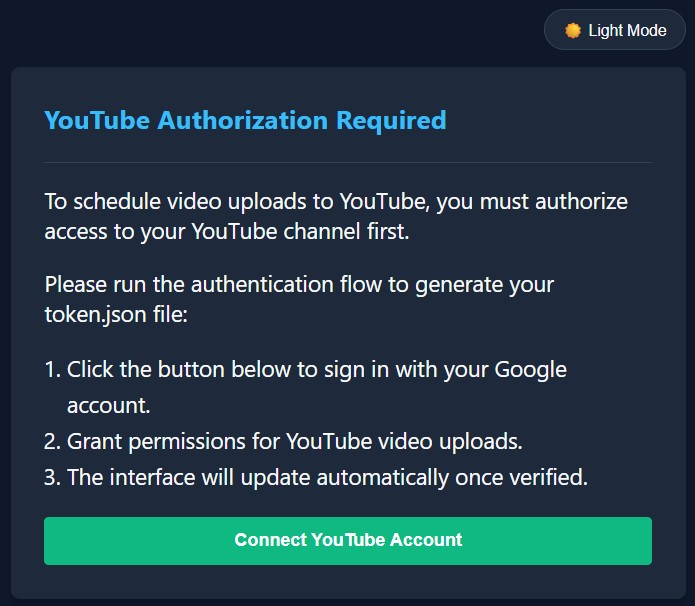
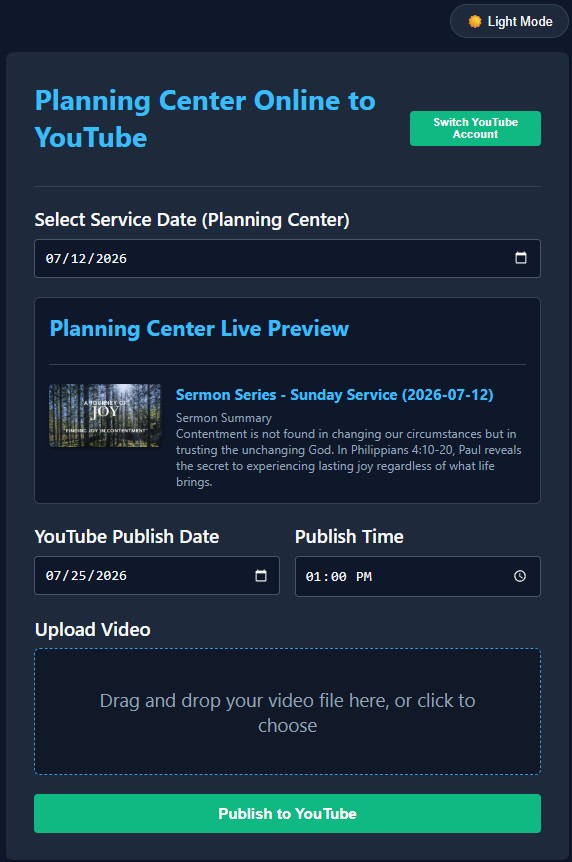

# Planning Center Online 2 YoutTube

A Flask-based web application that automates YouTube video uploads and metadata synchronization using the Planning Center Online (PCO) Services API and YouTube Data API v3.

## Features

- **Planning Center Integration:** Automatically fetches sermon series titles, plan descriptions, and artwork thumbnails based on selected service dates.
- **Custom YouTube Scheduling:** Pick a specific publish date and time independent of the service date.
- **Interactive UI:** Supports drag-and-drop file uploads, dark/light theme toggling, and live metadata previews.





---

## Setup & Credentials

Before running the container, obtain your API credentials:

### Step 1: Obtain Planning Center Personal Access Tokens

Planning Center uses token authentication with a `Client ID` (Application ID) and `Secret` (Secret Key).

1. Log into your account at [Planning Center Online](https://planningcenter.com).
2. Go to your Developer Portal at [api.planningcenteronline.com/oauth/applications](https://api.planningcenteronline.com/oauth/applications).
3. Under **Personal Access Tokens**, click **Create Personal Access Token**.
4. Enter a **Description** (e.g., `YouTube Media Sync Automation`).
6. Click **Submit**.
7. Copy the **Client ID** (`PCO_CLIENT_ID`) and **Secret** (`PCO_SECRET`).

---

### Step 2: Configure Google Auth Platform & OAuth 2.0 Credentials

1. **Enable the API:**
   - Go to [Google Cloud Console](https://console.cloud.google.com/).
   - Select your project, navigate to **APIs & Services > Library**, search for **YouTube Data API v3**, and click **Enable**.

2. **Initial "Get Started" Wizard:**
   - Navigate to **APIs & Services > Google Auth Platform** (or *OAuth consent screen*).
   - Click **Get Started** and fill out the initial setup:
     - **App Information:** Enter **App Name** (e.g., `Media Automation Sync`) and select your **User support email**.
     - **Audience:** Choose **External** (or **Internal** if using a Google Workspace organization).
     - **Contact Information:** Provide your developer contact email.
     - **Agreement:** Agree to the Google API Services: User Data Policy and finish the wizard.

3. **Create OAuth Client Credentials:**
   - Go to the **Clients** tab (or **APIs & Services > Credentials**).
   - Click **+ Create Client** (or **Create Credentials > OAuth client ID**).
   - Set **Application type** to **Web application**.
   - Set **Name** to `YouTube Media Automation`.
   - Under **Authorized redirect URIs**, add your callback URI:
     - `http://localhost:5000/oauth2callback` *(or your `https://` domain URL if hosting remotely)*
   - Click **Create**.
   - Click **Download JSON** for the newly created client, rename the downloaded file to `client_secrets.json`, and place it in your application root folder.

4. **Configure Data Access (Scopes):**
   - Go to the **Data Access** tab.
   - Click **Add or Remove Scopes**.
   - Search for and select: `https://www.googleapis.com/auth/youtube.upload`
   - Click **Update** and **Save**.

5. **Configure Audience (Test Users):**
   - Go to the **Audience** tab.
   - Under **Test users**, click **Add users**.
   - Add your Google account email address (and any other accounts uploading videos) so they are authorized during testing mode, then click **Save**.

---
### Step 3: Optional HTTPS & Self-Signed Certificates (For Remote Servers)

If your app is hosted on a remote server and requires an HTTPS connection for Google Authentication, you can generate and mount a self-signed certificate.

### 3.1 Generate the Certificate Files
Run the following OpenSSL command on your host machine to generate the required private key and certificate. 

> **Important Domain Note:** The domain name you choose **must end with a public top-level domain (TLD)** (such as `.com`, `.net`, or a domain you own)—even if the application is purely internal and not publicly exposed. Avoid using `.local`, as it is reserved for mDNS and can cause browser or resolution conflicts. Replace `myserver.com` below with your chosen domain:

```bash
openssl req -x509 -nodes -days 365 -newkey rsa:2048 \
  -keyout key.pem -out cert.pem \
  -subj "/CN=myserver.com"
```

### 3.2: Configure Hostname Resolution (Client Machine)

Because Google OAuth and browser TLS checks require a valid domain/hostname match for self-signed certificates, raw IP addresses cannot be used. You must map your server's hostname (`myserver.com`) to the remote server's IP address on the client machine accessing the app:

* **Option A (Local `hosts` file):** Add an entry pointing the server IP to your chosen domain on your client machine:
  * **Windows:** Open `C:\Windows\System32\drivers\etc\hosts` as Administrator.
  * **macOS / Linux:** Edit `/etc/hosts` using `sudo nano /etc/hosts`.
  * **Entry format:** `192.168.1.150 myserver.com` *(Replace `192.168.1.150` with your actual remote server IP address).*
* **Option B (Local DNS A Record):** Create a local DNS A record on your network router or internal DNS server (like Pi-hole or AdGuard Home) mapping `myserver.com` directly to your remote server's IP address.
---
### Environment Variables

Set the following environment variables in your runtime environment or Docker setup:

| Variable | Description | Default |
| :--- | :--- | :--- |
| `FLASK_SECRET_KEY` | Secret key for Flask session security | *(Auto-generated if omitted)* |
| `PCO_CLIENT_ID` | Planning Center Application ID | **Required** |
| `PCO_SECRET` | Planning Center Secret Key | **Required** |
| `TARGET_TIMEZONE` | Timezone for scheduled publish dates | `America/New_York` |
| `USE_PROXY` | Set `true` if running behind reverse proxy (Nginx/Traefik) | `false` |

## Edit docker-compose.yaml

Environment variables

    - PCO_CLIENT_ID= # PCO client ID
    - PCO_SECRET= # PCO secret
    - TARGET_TIMEZONE=America/New_York

Prepare persistent volumes

    # Mount YouTube credentials read-only
    - ./client_secrets.json:/app/client_secrets.json:ro
    - ./cert.pem:/app/cert.pem:ro
    - ./key.pem:/app/key.pem:ro

    # Alternatively Mount application code for hot reloading / persistent context
    - ./:/app


## Build and run with Docker Compose 

`docker compose build --no-cache && docker compose up -d`
